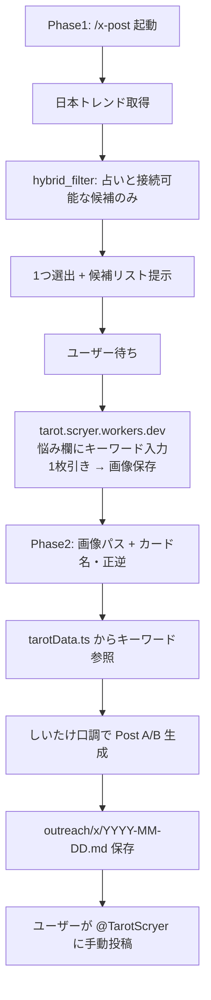

# TarotScryer X 投稿スキル仕様書

> **作成背景**: Matt Pocock の "grill-me" メソッド（深掘り質問による要件明確化）により複数ラウンドで採択された仕様を記録したもの。
> このドキュメントが X 投稿ドラフト生成スキル（`/x-post`）の **Single Source of Truth** となる。

## 1. 概要

**目的**: [TarotScryer](https://tarot.scryer.workers.dev) の公式 X アカウント（[https://x.com/TarotScryer](https://x.com/TarotScryer)）向けに、**日本の X トレンドをテーマにした1枚引き**の投稿ドラフトを生成し、Markdown ファイルとして保存する Grok スキルを提供する。

**運営関係**:
- **投稿アカウント**: [@TarotScryer](https://x.com/TarotScryer)
- **運営者**: しいたけ.（[@shiitake7919](https://x.com/shiitake7919)）
- 投稿は **しいたけ. の語り口**で書く（一般的な占い師キャラではなく、運営者本人が結果を共有するトーン）
- @TarotScryer のプロフィールに運営者開示を推奨（例: 「運営: しいたけ. @shiitake7919」）

**スコープ外**:
- X API による自動投稿
- スケジューラ・ボット連携
- スキル側での画像生成・合成
- `x.com/explore` の直接スクレイピング（ログイン壁・不安定・規約上グレー）

X の利用規約に配慮し、**すべての投稿はユーザーが手動で行う**。

## 2. Grill-me メソッドで採択された主要決定事項

### 2.1 アカウント・語り口
- **採択**: @TarotScryer は しいたけ.（@shiitake7919）が運用する
- **語り口**: `references/shiitake-voice.md` に従う（公開プロフィール・投稿からエージェントが草案を作成し、ユーザーが後から修正）
- 一人称は「私」または省略。体験ベース（「引いてみた」「作ってみた」）を許可
- 絵文字は控えめ（Post A で 0〜1 個）
- MOL（Method of Levels）や心理学的内省は**前面に出さない**
- アプリ本体（`spec.md`）のトーンとは意図的に分離する
  - アプリ: 内省・気づき・MOL
  - X 投稿: しいたけ. がトレンドテーマでタロットを引いた体験共有

### 2.2 コンテンツの源泉（2フェーズワークフロー）
- **採択**: スキルを **Phase 1 → 占い → Phase 2** の順で使う

**Phase 1（トレンド選出）** — 画像なし:
1. 日本の X トレンドを取得（[getdaytrends.com/japan](https://getdaytrends.com/japan/) + `WebSearch`）
2. **占いと自然につながるトレンドだけ**を候補に残す（hybrid_filter）
3. 候補から **1 つ選出**し、ユーザーに提示
4. ユーザーへ次アクションを案内: 悩み欄にキーワードを入れて 1 枚引き → 画像保存

**Phase 2（文案生成）** — 画像あり:
- スキルへの入力:
  - 画像ファイルの絶対パス（例: `~/Downloads/tarot-result.png`）
  - スプレッド: 原則 `single`（トレンド連動は 1 枚引き固定）
  - カード: 日本語名・正逆位置
  - Phase 1 で選出したトレンドキーワード（再確認用）
- LLM 解釈全文のコピペは**不要**（`src/lib/tarotData.ts` のキーワードを文案素材に使う）

**TarotScryer での占い方（Phase 1 → 2 の間）**:
1. `https://tarot.scryer.workers.dev` を開く
2. 1 枚引きを選択
3. 「タロットに聞きたいこと」欄に **選出トレンドのキーワード**を入力（`WorryInput`）
4. 背面カードから 1 枚選択
5. 結果画面の「画像を保存」で `tarot-result.png` を保存

### 2.3 1回の出力
- **採択**: **2本必須**
  - **Post A**: トレンドテーマ + 今日の1枚リーディング投稿（画像添付）
  - **Post B**: Post A 連動の招待投稿（同じセッションのカードをフックに、続きを促す）

### 2.4 日本トレンド戦略（hybrid_filter）
- **採択**: 占いと**自然に接続できる**トレンドのみ採用。無関係なバズタグは除外
- トレンドは **悩み入力のテーマ** + **Post A のハッシュタグ 1 個** に使う
- 取得元:
  - 一次: [getdaytrends.com/japan](https://getdaytrends.com/japan/)（`WebFetch`）
  - 補助: `WebSearch`（例: `X 日本 トレンド 今日`）
  - 目視確認: ユーザーが [x.com/explore](https://x.com/explore) で確認可能（Markdown に記録）
- **採用候補**: 季節・祝日・恋愛・仕事・健康・生活・感情に結びつく話題
- **除外**: スポーツ試合速報・政治・災害・訃報・企業プロモ長文タグ・意味不明なバズ
- **長いタグ**: 文字数上限（Post A ≤ 150字）を圧迫するため、短い候補を優先。長すぎる場合は別候補に差し替え
- **候補 0 件の日**: 無理に無関係タグは使わない。explore 目視 or 別タイミング再実行を案内

詳細ルール: `references/trend-filter.md`

### 2.5 ハッシュタグ戦略
- **Post A デフォルト（3個固定）**: `#（選出トレンド1個） #タロット #占い`
  - `#今日の運勢` はトレンドタグに置き換え（文字数節約）
  - トレンドが既に `#` 付きならそのまま、なければ付与
- **Post B デフォルト（3個固定）**: `#タロット #タロット占い #占い`
  - トレンドタグは Post B には入れない（本文でテーマに触れるのは可）
- 差し替えルール:
  - トレンド以外のタグは原則固定（コア2個）
  - スパム・禁止系タグは除外
  - 無関係トレンドをタグに付けない（ハッシュタグスパム回避）

### 2.6 画像
- **採択**: ユーザーが「画像を保存」で取得した `tarot-result.png` を X に**手動添付**
- スキルは画像ファイルを生成・コピーしない
- Markdown に画像の絶対パスを記録する
- 画像の内容: `ReadingResult.tsx` の `capture-target` 領域（カード・解釈文・免責文を含む）

### 2.7 リンク・CTA
- **Post A（今日の1枚）**: リンク**なし**
- **Post B（Post A 連動）**: `https://tarot.scryer.workers.dev` を **1回だけ** 含める
- Post B 本文にサービス名 `TarotScryer` は**入れない**（URL とアカウントで十分）
- `https://x.com/TarotScryer` は Markdown のメタ情報に記載

### 2.7.1 Post B の Post A 連動ルール（型3: カードメッセージの橋渡し型）
- **採択**: Post B は **型3をデフォルト** とする
- 1文目: Post A の **ヒント・キーワード**を拾い、**カード略称**（ナイト、教皇 等）で締める
  - 例: `派手さより着実な一歩、とナイトが言ってた。`
- 2文目: **トレンドの余韻**（エンタメ）または **気になった人は**（生活系）+ 同じテーマで3枚引き + 裏向きから直感で
- 訴求の柱: Post A の読後感の延長 → **同じテーマで深掘り**（悩み入力・3枚引き）
- 「無料」は前面に出さない。しいたけ. 口調の柔らかい招待（「試せます」「よければ」）
- トレンドタグは Post B には付けない（本文でテーマに触れる）

### 2.8 免責・注意書き
- **採択**: ポスト本文には免責を**入れない**
- 免責は保存済み PNG 内の文言に任せる（`ReadingResult.tsx` の disclaimer）

### 2.9 文字数（タグ込み合計）
- **採択**: **コピペ用ブロック全体**でカウント（本文 + 改行 + ハッシュタグ）
- **Post A**: 目標 **≤ 140字**、上限 **150字**（実投稿でタグ込み147字が限界となった）
- **Post B**: 上限 **220字**（URL 含む）
- 詳細は添付画像に載るため、Post A の本文は短くてよい
- 絵文字は X 上で2字扱いになりうるため、余裕を見る
- トレンドタグが長い場合は本文をさらに短くする

### 2.9.1 コピペ用ブロック
- **採択**: Markdown に **タグ込みの投稿全文**を1ブロックで記載し、そのまま X に貼れる形式にする
- 本文とハッシュタグを別欄にしない（2回コピペを廃止）

### 2.10 自動投稿
- **採択**: **しない**
- Markdown に手動投稿チェックリストを含める

### 2.11 スキル配置・呼び出し
- **配置**: `.grok/skills/x-post/SKILL.md`
- **スキル名**: `x-post`（Grok スキル名は 2〜64 文字が必要。ユーザー希望の `/x` は `description` に記載）
- **トリガー**: `/x-post`, `/x`, `X投稿`, `Twitter`, `ハッシュタグ`, `outreach`, `TarotScryer`
- **Phase 判定**: 画像パスが未指定 → Phase 1（トレンド選出）。画像パスあり → Phase 2（文案生成）

### 2.12 ドラフト保存先
- **採択**: `outreach/x/YYYY-MM-DD.md`（日付1ファイル）
- Phase 1 のみ完了した場合も同日ファイルにトレンド選出結果を追記可（Phase 2 完了時に上書き前にユーザー確認）

## 3. ワークフロー



### 3.1 運用手順

1. `/x-post`（または `/x`）を実行 → **Phase 1**: トレンド1件が選出される
2. 選出キーワードを `https://tarot.scryer.workers.dev` の悩み欄に入力し、**1枚引き**で占う
3. 結果画面の「画像を保存」で PNG を保存
4. `/x-post` を再実行し、画像パス・カード名・正逆を渡す → **Phase 2**: 文案生成
5. `outreach/x/YYYY-MM-DD.md` を開く
6. チェックリストに従い、手動で @TarotScryer に投稿
7. Post B（招待）は任意で別日に投稿

## 4. スキル実装構成

```
.grok/skills/x-post/
  SKILL.md                          # エージェント向け実行手順（本体）
  references/
    markdown-template.md            # 出力 Markdown の固定構造
    voice-guide.md                  # shiitake-voice への委譲 + 共通ルール
    shiitake-voice.md               # しいたけ. の語り口（草案・テンプレ）
    trend-filter.md                 # トレンド取得・フィルタ・選出ルール
    hashtag-seeds.md                # コアタグ・調査手順

outreach/x/
  YYYY-MM-DD.md                     # 生成されたドラフト（git 管理は運用次第）
  .gitkeep                          # ディレクトリ初期化用
```

## 5. スキル実行手順（SKILL.md の内容）

### Phase 1: トレンド選出

1. **トレンド取得**: getdaytrends Japan + `WebSearch`
2. **フィルタ**: `trend-filter.md` に従い候補を絞る
3. **1つ選出**: 採用理由・除外例・候補リストをユーザーに提示
4. **次アクション案内**: 悩み欄入力 → 1枚引き → 画像保存 → Phase 2

### Phase 2: 文案生成

1. **入力収集**（不足時はヒアリング）: 画像パス・カード名・正逆・トレンドキーワード
2. **画像存在確認**
3. **カード文脈の取得**: `src/lib/tarotData.ts` から該当カードの `keywords` / `keywordsReversed` を参照
4. **文案生成**（2本、コピペ用ブロック形式、`shiitake-voice.md` 準拠）:
   - トレンド種別から接続パターン A/B/C を選定
   - Post A: トレンド体験の延長 + パターンに応じたフック + タグ3個（トレンド1 + コア2）、タグ込み ≤ 150字、リンクなし、画像添付
   - Post B: 型3（Post A ヒント + カード略称 + トレンド余韻 + 3枚引き体験）+ URL + タグ3個、タグ込み ≤ 220字、画像なし
5. **Markdown 保存**: `outreach/x/YYYY-MM-DD.md` にコピペ用ブロック付きで書き込み
6. **禁止事項の遵守**: 自動投稿・API 連携・ボット投稿は行わない

## 6. 文案ガイドライン

詳細は `references/shiitake-voice.md` を参照。

### 6.0 Post A の基本構造

```
[トレンドへの個人的反応] → [その状態でタロットを引いた] → [橋渡し1文（任意）] → 【カード】→ [キーワードヒント] → [タグ]
```

タグのための占いではなく、**トレンド体験の延長**として書く。

### 6.0.1 接続パターン（トレンド種別で選択）

| パターン | 向くトレンド | 要点 |
|---------|-------------|------|
| **A: ファン感情型** | 番組・推し・エンタメ | 視聴感情 → 引いた → 橋渡し1文（ユーモア可） |
| **B: 気分・生活型** | 季節・日常・感情語 | 気になって → 引いた → ヒント |
| **C: 観察型** | TL の話題だけ拾う日 | TL占領 → 自分の1枚 → ヒント |

エンタメトレンドは **パターン A をデフォルト** とする。

### 6.1 使う表現
- 「引いてみた」「○○でキュン死すぎて」「リピート視聴しながら」
- トレンドキーワードを自然なフックに
- 橋渡し: 「私の中の○○はナイト」「解釈違いは許して」（パターン A・1文まで）
- カード名（日本語）+ キーワードを自然に織り込む

### 6.2 避ける表現
- 一般的な占い師キャラ口調（「お客様へ」「本日の運勢をお届け」等）
- MOL の問いかけ（「この状況の背後に…」等）
- 心理療法用語
- 決定論的な未来予言（「絶対うまくいく」「運命が決まった」等）
- 過度なオカルト表現
- 無関係トレンドへの無理な言及（ハッシュタグスパム）

### 6.3 挨拶と投稿時刻
| 時間帯 | 挨拶の例 |
|--------|---------|
| 朝（〜11時） | `おはようございます`（絵文字は任意・控えめ） |
| 昼以降〜夜 | 挨拶なしでトレンドフックから入る |
| 深夜（0時〜5時） | `おはよう` は使わない |

### 6.4 Post A（トレンド + 1枚引き）の構成例（コピペ用）

**パターン A**（エンタメ・実投稿例: [キテレツキテル × ペンタクルのナイト](https://x.com/TarotScryer/status/2068615526755283430)）:
```
キテレツキテルでキュン死すぎてを何度もリピート視聴しながら、タロット1枚引いてみた。私の中の大昇くんはナイト。解釈違いは許して。
【ペンタクルのナイト・正位置】
派手さより着実な一歩。焦らず積み重ねる日。

#キテレツキテル #タロット #占い
```

**パターン B**（季節・生活）:
```
梅雨の足音が気になって、タロットを1枚引いてみた。
【星・逆位置】
迷いの霧の中でも、内なる光は消えていない。焦らず自分のペースで。

#梅雨 #タロット #占い
```

### 6.5 Post B（型3: カードメッセージの橋渡し型）の構成例（コピペ用）

Post A がキテレツキテル × ペンタクルのナイトなら:
```
派手さより着実な一歩、とナイトが言ってた。
キテレツの余韻が残ってる人は、同じテーマで3枚引きも試せます。裏向きから直感で。
https://tarot.scryer.workers.dev

#タロット #タロット占い #占い
```

Post A が梅雨 × 星（逆位置）なら:
```
ゆっくりでいい、と星が言ってた。
梅雨が気になった人は、同じテーマで3枚引きも試せます。裏向きから直感で。
https://tarot.scryer.workers.dev

#タロット #タロット占い #占い
```

## 7. Markdown 出力テンプレート

```markdown
# X 投稿ドラフト — YYYY-MM-DD

## メタ情報
- 投稿アカウント: https://x.com/TarotScryer
- 運営者: しいたけ. — https://x.com/shiitake7919
- スプレッド: single
- 選出トレンド: （キーワード + 採用理由）
- 悩み入力キーワード: （TarotScryer に入力した文言）
- カード: ...
- 画像: /absolute/path/to/tarot-result.png

## トレンド調査メモ
- 調査日: ...
- 取得元: getdaytrends / WebSearch
- 採用トレンドと理由:
- 除外したトレンドと理由（例: スポーツ速報、政治、長文プロモタグ）

## ハッシュタグ
- Post A: #（トレンド） #タロット #占い
- Post B: #タロット #タロット占い #占い

## Post A: トレンド + 今日の1枚

### コピペ用（タグ込み・そのまま X に貼る）
```
（投稿全文）
```

**合計文字数:** N（150字以内）
**画像:** 添付する（tarot-result.png）
**リンク:** なし

## Post B: Post A 連動（招待）

### コピペ用（タグ込み・そのまま X に貼る）
```
{Post Aのヒント}、と{カード略称}が言ってた。
{トレンド}の余韻が残ってる人は、同じテーマで3枚引きも試せます。裏向きから直感で。
https://tarot.scryer.workers.dev

#タロット #タロット占い #占い
```

**合計文字数:** N（220字以内）
**型:** Post B 型3（カードメッセージの橋渡し型）
**画像:** なし
**リンク:** https://tarot.scryer.workers.dev

## 手動投稿チェックリスト
- [ ] 自動投稿ツールは使わない（X 規約配慮）
- [ ] トレンドタグが投稿内容と意味的に関連しているか確認
- [ ] Post A の「コピペ用」をそのままコピー
- [ ] 画像を添付（Post A）
- [ ] X の文字数カウンターで切れていないか確認
- [ ] Post A を @TarotScryer から投稿
- [ ] （任意・別日）Post B の「コピペ用」をコピーして投稿
```

## 8. ハッシュタグ・トレンド選定

### Post A / Post B デフォルトタグ
- Post A: `#（選出トレンド1個） #タロット #占い`
- Post B: `#タロット #タロット占い #占い`

### トレンド選定チェックリスト（hybrid_filter）
- [ ] 日本の当日トレンドとして実在するか（getdaytrends / explore で確認可能）
- [ ] 占い・内省・生活の選択に**自然につながる**か
- [ ] 悩み入力テーマとして使えるか
- [ ] タグとして付けてもスパムにならないか（無関係バズは除外）
- [ ] タグ込み合計が Post A ≤ 150字 / Post B ≤ 220字 か
- [ ] スパム・禁止系でないか

### コアタグ（Post A でトレンド以外に固定）
- `#タロット`
- `#占い`

## 9. 既存コードとの関係

| 既存ファイル | 関係 |
|-------------|------|
| `src/components/islands/WorryInput.tsx` | Phase 1 選出キーワードの入力先（1枚引きフローで利用可能） |
| `src/components/islands/TarotApp.tsx` | 1枚引き選択 → WorryInput → CardPicker の順で表示 |
| `src/components/islands/ReadingResult.tsx` | 「画像を保存」ボタンが `tarot-result.png` を生成。スキルはこの PNG を参照 |
| `src/lib/tarotData.ts` | カードの `keywords` / `keywordsReversed` を文案素材に使用 |
| `.claude/skills/tarot-domain.md` | 内省トーンのドメイン知識。X 投稿では `shiitake-voice.md` を優先 |
| `spec.md` | アプリ本体の仕様。X 投稿トーンとは意図的に分離 |

## 10. 禁止事項・コンプライアンス

### 10.1 スキル側の禁止（従来通り）
- X API・サードパーティツールによる**自動投稿は行わない**
- 投稿スケジューラ・ボットとの連携は行わない
- スキルはドラフト生成と Markdown 保存のみを担当する
- ユーザーが内容を確認し、手動で投稿する運用とする

### 10.2 トレンド連動の規約上の注意
| 項目 | 評価 | 対応 |
|------|------|------|
| 手動投稿のみ | 問題なし | 現行運用を維持 |
| 公式アカウントの個人運用 | 問題なし | プロフィールで運営者を開示 |
| 関連性のあるトレンドタグ | 条件付きOK | hybrid_filter で無関係タグを除外 |
| 無関係バズへのタグ付け | リスクあり | 候補0件の日は投稿スキップを推奨 |
| x.com/explore のスクレイピング | 非推奨 | getdaytrends + WebSearch + ユーザー目視 |

### 10.3 避けるべき運用
- スポーツ・政治・悲報系トレンドに無関係な占い + そのタグ
- 同一トレンドへの短時間の大量連投
- トレンドタグ + 占いタグを合計6個以上並べる

## 11. 検証

- [x] `.grok/skills/x-post/SKILL.md` のフォーマットが Grok スキル規約に準拠している
- [ ] `references/shiitake-voice.md` / `references/trend-filter.md` が SKILL.md から参照されている
- [ ] Phase 1 のみ実行 → トレンド1件 + 次アクションが出力される
- [ ] Phase 2（ダミー画像 + カード）→ Post A がしいたけ口調・トレンドタグ込み ≤ 150字
- [ ] スポーツ系トレンド日 → フィルタで除外され、代替候補 or スキップ案内になる
- [ ] Post B のコピペ用がタグ込み ≤ 220字・リンク1回である
- [ ] コピペ用ブロック1つで X にそのまま貼れる形式である

## 12. 変更履歴

### 2026-06-21: Post B を型3（カードメッセージの橋渡し型）に変更
- Post B デフォルトを「もう少し深く見たい方へ」から型3に変更
- Post A のヒント + カード略称 + トレンド余韻 + 同じテーマで3枚引き、の4層構造
- @shiitake7919 の「文脈→価値→リンク」型を Post B に適用

### 2026-06-21: トレンド×占いの接続パターン（A/B/C）を反映
- 実投稿（キテレツキテル × ペンタクルのナイト）を `shiitake-voice.md` の模範例に追加
- Post A をファン感情型 / 気分生活型 / 観察型の3パターンに分割
- 橋渡し1文 + 「解釈違いは許して」等のユーモア枠を明文化
- `SKILL.md` Phase 2 にパターン選定ステップを追加

### 2026-06-21: しいたけ口調 + 日本トレンド連動（2フェーズWF）
- 運営者を しいたけ.（@shiitake7919）に設定。@TarotScryer はその語り口で投稿
- ワークフローを Phase 1（トレンド選出）→ 占い → Phase 2（文案生成）に変更
- ハッシュタグ戦略を hybrid_filter に変更（占いと接続可能な日本トレンド1個 + コア2個）
- Post A デフォルトタグを `#（トレンド） #タロット #占い` に変更
- トレンド連動は 1 枚引き（single）固定。悩み欄に選出キーワードを入力
- 新規参照: `shiitake-voice.md`, `trend-filter.md`
- コンプライアンス節にトレンドタグ・ハッシュタグスパム回避を追加

### 2026-06-21: Post B を Post A 連動型に変更（案2）
- Post B を「週次ソフトプロモ」から「Post A 連動の招待投稿」に変更
- 同じセッションのカード名を1文目に必須で含める
- 体験訴求（裏向きカード・直感選択）+ 1枚/3枚の選択肢を前面に
- 本文から `TarotScryer` サービス名を削除（URL のみ）
- Post B デフォルトタグを `#タロット #タロット占い #占い` に変更

### 2026-06-20: 文字数・コピペ形式の改定
- 文字数を「本文のみ」から「タグ込み合計」に変更（Post A 上限150字）
- ハッシュタグを Post A 5個 → 3個固定に削減
- Markdown に「コピペ用」ブロックを追加（本文・タグの2段コピペを廃止）
- 投稿時刻に合った挨拶ルールを追加

---

**この仕様書は grill-me プロセスおよび 2026-06-21 の改訂でユーザーが明確に選択・承認した内容を反映しています。**
スキル実装・運用ルールの変更を行う場合は、この `spec_x.md` を更新してから実装すること。