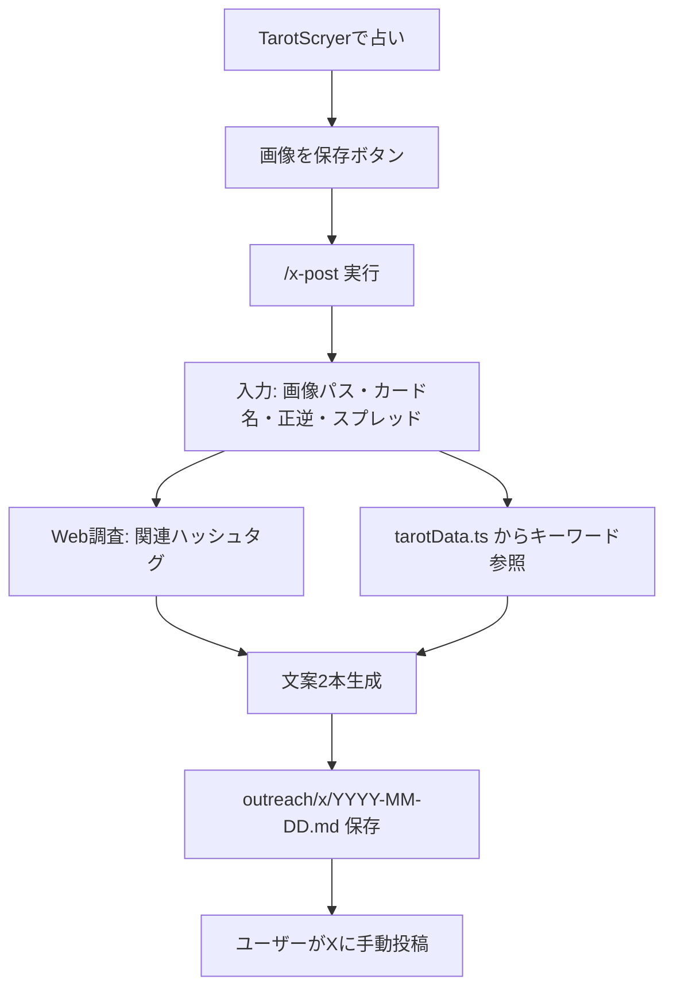

# TarotScryer X 投稿スキル仕様書

> **作成背景**: Matt Pocock の "grill-me" メソッド（深掘り質問による要件明確化）により複数ラウンドで採択された仕様を記録したもの。
> このドキュメントが X 投稿ドラフト生成スキル（`/x-post`）の **Single Source of Truth** となる。

## 1. 概要

**目的**: [TarotScryer](https://tarot.scryer.workers.dev) の公式 X アカウント（[https://x.com/TarotScryer](https://x.com/TarotScryer)）向けに、#タロット・#今日の運勢・#占い 等のハッシュタグタイムラインに自然に溶け込む投稿ドラフトを生成し、Markdown ファイルとして保存する Grok スキルを提供する。

**スコープ外**:
- X API による自動投稿
- スケジューラ・ボット連携
- スキル側での画像生成・合成

X の利用規約に配慮し、**すべての投稿はユーザーが手動で行う**。

## 2. Grill-me メソッドで採択された主要決定事項

### 2.1 コンテンツの源泉
- **採択**: 先に TarotScryer で占いを行い、結果画面の「画像を保存」ボタンで PNG を保存してからスキルを実行する
- スキルへの入力:
  - 画像ファイルの絶対パス（例: `~/Downloads/tarot-result.png`）
  - スプレッド: `single`（1枚引き）/ `three`（3枚引き）
  - カード: 日本語名・正逆位置（3枚の場合はポジション「状況・課題・助言」も）
- LLM 解釈全文のコピペは**不要**（`src/lib/tarotData.ts` のキーワードを文案素材に使う）

### 2.2 1回の出力
- **採択**: **2本必須**
  - **Post A**: 今日の1枚リーディング投稿
  - **Post B**: Post A 連動の招待投稿（同じセッションのカードをフックに、続きを促す）

### 2.3 トーン・文体
- **採択**: **完全に溶け込む**（一般的な運勢・占い口調）
- MOL（Method of Levels）や心理学的内省は**前面に出さない**
- アプリ本体（`spec.md`）のトーンとは意図的に分離する
  - アプリ: 内省・気づき・MOL
  - X 投稿: #今日の運勢 等のタイムラインに馴染む運勢・占い口調

### 2.4 ハッシュタグ戦略
- **採択**: **毎回 Web 調査**してデフォルトタグが有効か確認（問題なければ固定3個を使う）
- **Post A デフォルト（3個固定）**: `#タロット #占い #今日の運勢`（約16字）
- **Post B デフォルト（3個固定）**: `#タロット #タロット占い #占い`
- 変更理由: 5個（約34字）だとタグ込み合計が147字付近で X の実用限界に達した
- 差し替えルール:
  - 調査で明らかに優れた代替がある場合のみ、**3個のまま**同程度の長さに差し替え
  - 長いタグ（`#タロットカード` `#今日のタロット` 等）は Post A で原則使わない
  - スパム・禁止系タグは除外

### 2.5 画像
- **採択**: ユーザーが「画像を保存」で取得した `tarot-result.png` を X に**手動添付**
- スキルは画像ファイルを生成・コピーしない
- Markdown に画像の絶対パスを記録する
- 画像の内容: `ReadingResult.tsx` の `capture-target` 領域（カード・解釈文・免責文を含む）

### 2.6 リンク・CTA
- **Post A（今日の1枚）**: リンク**なし**
- **Post B（Post A 連動）**: `https://tarot.scryer.workers.dev` を **1回だけ** 含める
- Post B 本文にサービス名 `TarotScryer` は**入れない**（URL とアカウントで十分）
- `https://x.com/TarotScryer` は Markdown のメタ情報に記載

### 2.6.1 Post B の Post A 連動ルール
- **採択**: Post B は **Post A と同じセッションのカード名**を必ず1文目に含める
- 1枚引き: `今日の{カード名}、…`（例: 今日の教皇、もう少し深く見たい方へ。）
- 3枚引き: **状況ポジション**のカード名を使う（Post A と同じ主役カード）
- 訴求の柱: **体験**（裏向きカードから直感で選ぶ）+ **選択肢**（1枚 / 3枚引き）
- 「無料」は補足程度。前面に出すのは体験と Post A への続き感

### 2.7 免責・注意書き
- **採択**: ポスト本文には免責を**入れない**
- 免責は保存済み PNG 内の文言に任せる（`ReadingResult.tsx` の disclaimer）

### 2.8 文字数（タグ込み合計）
- **採択**: **コピペ用ブロック全体**でカウント（本文 + 改行 + ハッシュタグ）
- **Post A**: 目標 **≤ 140字**、上限 **150字**（実投稿でタグ込み147字が限界となった）
- **Post B**: 上限 **220字**（URL 含む）
- 詳細は添付画像に載るため、Post A の本文は短くてよい
- 絵文字は X 上で2字扱いになりうるため、余裕を見る

### 2.8.1 コピペ用ブロック
- **採択**: Markdown に **タグ込みの投稿全文**を1ブロックで記載し、そのまま X に貼れる形式にする
- 本文とハッシュタグを別欄にしない（2回コピペを廃止）

### 2.9 自動投稿
- **採択**: **しない**
- Markdown に手動投稿チェックリストを含める

### 2.10 スキル配置・呼び出し
- **配置**: `.grok/skills/x-post/SKILL.md`
- **スキル名**: `x-post`（Grok スキル名は 2〜64 文字が必要。ユーザー希望の `/x` は `description` に記載）
- **トリガー**: `/x-post`, `/x`, `X投稿`, `Twitter`, `ハッシュタグ`, `outreach`, `TarotScryer`

### 2.11 ドラフト保存先
- **採択**: `outreach/x/YYYY-MM-DD.md`（日付1ファイル）

## 3. ワークフロー



### 3.1 運用手順

1. `https://tarot.scryer.workers.dev` で占う（1枚 or 3枚）
2. 結果画面の「画像を保存」で PNG を保存
3. `/x-post`（または `/x`）を実行し、画像パスとカード情報を渡す
4. `outreach/x/YYYY-MM-DD.md` を開く
5. チェックリストに従い、手動で X に投稿
6. Post B（プロモ）は任意で別日に投稿

## 4. スキル実装構成

```
.grok/skills/x-post/
  SKILL.md                          # エージェント向け実行手順（本体）
  references/
    markdown-template.md              # 出力 Markdown の固定構造
    voice-guide.md                  # X 投稿用トーンガイド
    hashtag-seeds.md                # ハッシュタグ調査の起点リスト

outreach/x/
  YYYY-MM-DD.md                     # 生成されたドラフト（git 管理は運用次第）
  .gitkeep                          # ディレクトリ初期化用
```

## 5. スキル実行手順（SKILL.md の内容）

1. **入力収集**（不足時はヒアリング）
2. **カード文脈の取得**: `src/lib/tarotData.ts` から該当カードの `keywords` / `keywordsReversed` を参照
3. **ハッシュタグ調査**: `WebSearch` でデフォルト3タグが有効か確認（問題なければ固定を使う）
4. **文案生成**（2本、コピペ用ブロック形式）:
   - Post A: 3行テンプレ + タグ3個、タグ込み ≤ 150字、リンクなし、画像添付
   - Post B: Post A 連動（同カード名 + 体験訴求）+ URL + タグ3個、タグ込み ≤ 220字、画像なし
5. **Markdown 保存**: `outreach/x/YYYY-MM-DD.md` にコピペ用ブロック付きで書き込み
6. **禁止事項の遵守**: 自動投稿・API 連携・ボット投稿は行わない

## 6. 文案ガイドライン

### 6.1 使う表現
- 「今日の運勢」
- 「カードが伝えるメッセージ」
- 「ちょっとしたヒント」
- カード名（日本語）+ キーワードを自然に織り込む

### 6.2 避ける表現
- MOL の問いかけ（「この状況の背後に…」等）
- 心理療法用語
- 決定論的な未来予言（「絶対うまくいく」「運命が決まった」等）
- 過度なオカルト表現

### 6.3 挨拶と投稿時刻
| 時間帯 | 挨拶の例 |
|--------|---------|
| 朝（〜11時） | `おはようございます☀️` |
| 昼以降〜夜 | `こんばんは🌙` または挨拶なし |
| 深夜（0時〜5時） | `おはよう` は使わない |

### 6.4 Post A（今日の1枚）の構成例（コピペ用）
```
こんばんは🌙 土曜の運勢、一枚引きました。
【教皇・正位置】
信頼できる人の助言や、慣れたやり方がヒントに。伝統を尊重しつつ、自分らしい答えを。

#タロット #占い #今日の運勢
```

### 6.5 Post B（Post A 連動）の構成例（コピペ用）

**1枚引きの場合**（Post A が教皇なら）:
```
今日の教皇、もう少し深く見たい方へ。
裏向きのカードから直感で選ぶだけ、3枚引きも無料です。
https://tarot.scryer.workers.dev

#タロット #タロット占い #占い
```

**3枚引きの場合**（状況カードが教皇なら）:
```
今日の教皇、気になった方へ。
悩みを書いて3枚引き（状況・課題・助言）もできます。
裏向きのカードから直感で選ぶだけ。
https://tarot.scryer.workers.dev

#タロット #タロット占い #占い
```

## 7. Markdown 出力テンプレート

```markdown
# X 投稿ドラフト — YYYY-MM-DD

## メタ情報
- アカウント: https://x.com/TarotScryer
- スプレッド: single | three
- カード: ...
- 画像: /absolute/path/to/tarot-result.png

## ハッシュタグ調査メモ
- 調査日: ...
- Post A / Post B の採用タグと理由

## Post A: 今日の1枚

### コピペ用（タグ込み・そのまま X に貼る）
```
（投稿全文）
```

**合計文字数:** N（150字以内）
**画像:** 添付する（tarot-result.png）
**リンク:** なし

## Post B: Post A 連動（招待）

### コピペ用（タグ込み・そのまま X に貼る）
```
今日の{カード名}、…
（体験訴求 + 1枚/3枚の選択肢）
https://tarot.scryer.workers.dev

#タロット #タロット占い #占い
```

**合計文字数:** N（220字以内）
**連動カード:** Post A と同じカード名
**画像:** なし
**リンク:** https://tarot.scryer.workers.dev

## 手動投稿チェックリスト
- [ ] 自動投稿ツールは使わない（X 規約配慮）
- [ ] Post A の「コピペ用」をそのままコピー
- [ ] 画像を添付（Post A）
- [ ] X の文字数カウンターで切れていないか確認
- [ ] Post A を投稿
- [ ] （任意・別日）Post B の「コピペ用」をコピーして投稿
```

## 8. ハッシュタグシードリスト

調査の起点として使用する。毎回すべてを使うわけではない。

| カテゴリ | シードタグ |
|---------|-----------|
| コア | `#タロット` `#占い` `#タロット占い` |
| 運勢系 | `#今日の運勢` `#運勢` `#開運` `#毎日占い` |
| タロット特化 | `#タロットカード` `#今日のタロット` `#タロットリーディング` |
| 自己成長 | `#心理タロット` `#スピリチュアル` `#自己啓発` |
| 曜日・時間 | `#月曜日の運勢` `#朝占い` 等（当日に応じて） |

### Post A / Post B デフォルトタグ
- Post A: `#タロット #占い #今日の運勢`
- Post B: `#タロット #タロット占い #占い`

### 選定チェックリスト
- [ ] 日本語圏で実際に使われているタグか
- [ ] 投稿内容と意味的に合っているか
- [ ] **3個**に収まっているか
- [ ] タグ込み合計が Post A ≤ 150字 / Post B ≤ 220字 か
- [ ] スパム・禁止系でないか

## 9. 既存コードとの関係

| 既存ファイル | 関係 |
|-------------|------|
| `src/components/islands/ReadingResult.tsx` | 「画像を保存」ボタンが `tarot-result.png` を生成。スキルはこの PNG を参照 |
| `src/lib/tarotData.ts` | カードの `keywords` / `keywordsReversed` を文案素材に使用 |
| `.claude/skills/tarot-domain.md` | 内省トーンのドメイン知識。X 投稿では `voice-guide.md` を優先 |
| `spec.md` | アプリ本体の仕様。X 投稿トーンとは意図的に分離 |

## 10. 禁止事項・コンプライアンス

- X API・サードパーティツールによる**自動投稿は行わない**
- 投稿スケジューラ・ボットとの連携は行わない
- スキルはドラフト生成と Markdown 保存のみを担当する
- ユーザーが内容を確認し、手動で投稿する運用とする

## 11. 検証

- [x] `.grok/skills/x-post/SKILL.md` のフォーマットが Grok スキル規約に準拠している
- [x] `references/` 配下の3ファイルが SKILL.md から参照されている
- [ ] ダミー入力で `outreach/x/YYYY-MM-DD.md` にコピペ用ブロックが含まれる
- [ ] Post A のコピペ用がタグ込み ≤ 150字・リンクなし・運勢口調である
- [ ] Post B のコピペ用がタグ込み ≤ 220字・リンク1回である
- [ ] コピペ用ブロック1つで X にそのまま貼れる形式である

## 12. 変更履歴

### 2026-06-21: Post B を Post A 連動型に変更（案2）
- Post B を「週次ソフトプロモ」から「Post A 連動の招待投稿」に変更
- 同じセッションのカード名を1文目に必須で含める
- 体験訴求（裏向きカード・直感選択）+ 1枚/3枚の選択肢を前面に
- 本文から `TarotScryer` サービス名を削除（URL のみ）
- Post B デフォルトタグを `#タロット #タロット占い #占い` に変更

### 2026-06-20: 文字数・コピペ形式の改定
- 文字数を「本文のみ」から「タグ込み合計」に変更（Post A 上限150字）
- ハッシュタグを Post A 5個 → 3個固定に削減
- Markdown に「コピペ用」ブロックを追加（本文・タグの2段コピペを廃止）
- 投稿時刻に合った挨拶ルールを追加

---

**この仕様書は grill-me プロセスでユーザーが明確に選択・承認した内容を反映しています。**
スキル実装・運用ルールの変更を行う場合は、この `spec_x.md` を更新してから実装すること。